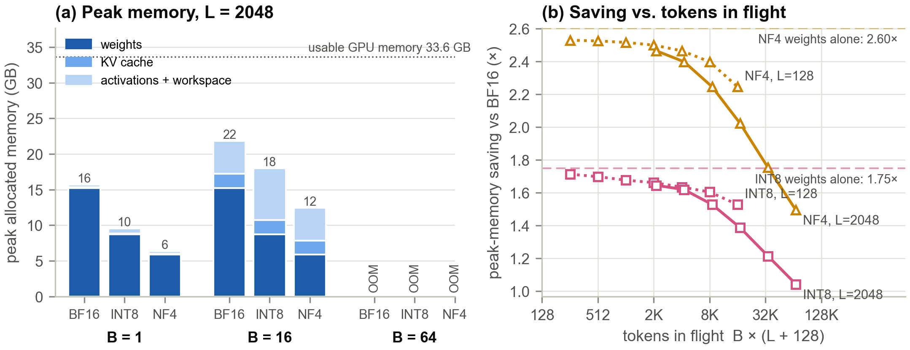

# Smaller Is Not Always Faster
### The memory–performance trade-off of LLM quantization on an RTX 5090

CSE 6359 Advanced Topics in Systems & Architecture — Final Project, Fall 2026
**Sijia Zhong · Zheng Zheng · Haofei Sun**

📄 **Report:** [`report/main.pdf`](report/main.pdf) · 🎞️ **Slides:** [`slides/final_presentation.pptx`](slides/final_presentation.pptx) · 📝 Proposal: [`proposal/`](proposal/)

<!-- KEY-FINDINGS -->
## Key findings

1. **Memory — smaller, but not 4× smaller.** Only the decoder's linear layers shrink; the embedding,
   LM head, norms and quantization scales stay 16-bit. On Qwen2.5-7B, 4-bit weights save
   **2.60×** (NF4) to **2.70×** (AWQ) instead of 4×, and INT8 **1.75×** instead of 2×.
   At run time the KV cache and activations are not quantized: at 32 × 2048-token prompts the
   end-to-end saving falls to **1.49×** (NF4) and **1.04×** (LLM.int8(), whose activation
   workspace is 1.6× that of BF16).
2. **Speed depends on the kernel, not the bit-width.** At batch size 1, AWQ-INT4 with vLLM's Marlin
   kernel decodes **2.44× faster** than BF16, while bitsandbytes LLM.int8() is **3.4× slower**
   and NF4 is 1.13× faster on 7B but 1.39× slower on 3B (whose BF16 step is host-bound).
3. **Weight-only gains vanish in the compute-bound regime.** AWQ-INT4 stops winning around
   **B ≈ 175** (512-token prompts) and never shortens prefill; **FP8 W8A8 is faster in every
   cell** (1.59×–1.80× end to end) and delivers **1.73×** the BF16 throughput at B = 256.
4. **The mechanism is visible at kernel level.** On the measured roofline, 4-bit weights quadruple
   arithmetic intensity, so Marlin W4A16 is 3.2× faster than cuBLAS at M = 1 and crosses over at
   M ≈ 333; LLM.int8() keeps the GPU busy only 28% of a decode step (BF16: 97%).
5. **Energy follows latency.** At batch size 1, AWQ-INT4 needs 1.9 J per token against
   4.9 J for BF16; at B = 256 the GPU is power-capped and only FP8 still saves energy.
6. **Quality.** 
<!-- /KEY-FINDINGS -->

## What we measured

| | |
|---|---|
| **GPU** | NVIDIA GeForce RTX 5090 (Blackwell, sm_120, 32 GB GDDR7, 170 SMs), driver 595.91 |
| **Software** | PyTorch 2.13 (CUDA 13.0), Transformers 5.19, bitsandbytes 0.50.2, vLLM 0.32 — pinned in [`requirements.txt`](requirements.txt) |
| **Models** | Qwen2.5-3B / 7B / 14B-Instruct |
| **Configurations** | HF + bitsandbytes: BF16, INT8 (LLM.int8()), NF4 · vLLM: BF16, FP8 W8A8, GPTQ-INT8 (W8A16), AWQ-INT4 and GPTQ-INT4 (W4A16, Marlin kernels) |
| **Workloads** | controlled sweep (batch 1–256 × prompt 128–2048 tokens, 128 generated tokens) · 300 ShareGPT requests replayed at 1–64 concurrent clients · WikiText-2 perplexity · GSM8K (all 1,319 questions) |
| **Metrics** | weight + peak memory, KV-cache capacity, TTFT, TPOT, throughput, GPU energy per token, perplexity, accuracy; kernel microbenchmarks, measured roofline, per-step profiles |

<!-- RESULTS -->
## Results at a glance

**Q1 — weight memory (GB)**

| Model       | Config             |   Naive (GB) |   Model (GB) | Measured (GB)   | Ratio vs BF16   | Naive ratio   |
|:------------|:-------------------|-------------:|-------------:|:----------------|:----------------|:--------------|
| Qwen2.5-3B  | HF BF16            |         6.17 |         6.17 | 6.17            | 1.00×    | 1.00×  |
| Qwen2.5-3B  | HF INT8 (LLM.int8) |         3.09 |         3.4  | 3.40            | 1.81×    | 2.00×  |
| Qwen2.5-3B  | HF NF4             |         1.54 |         2.18 | 2.20            | 2.81×    | 4.00×  |
| Qwen2.5-3B  | vLLM BF16          |         6.17 |         6.17 | 6.22            | 1.00×    | 1.00×  |
| Qwen2.5-3B  | vLLM FP8 W8A8      |         3.09 |         3.4  | 3.47            | 1.79×    | 2.00×  |
| Qwen2.5-3B  | vLLM GPTQ W8A16    |         3.09 |         3.46 | 3.51            | 1.77×    | 2.00×  |
| Qwen2.5-3B  | vLLM AWQ W4A16     |         1.54 |         2.06 | 2.09            | 2.97×    | 4.00×  |
| Qwen2.5-3B  | vLLM GPTQ W4A16    |         1.54 |         2.06 | 2.08            | 2.98×    | 4.00×  |
| Qwen2.5-7B  | HF BF16            |        15.23 |        15.23 | 15.23           | 1.00×    | 1.00×  |
| Qwen2.5-7B  | HF INT8 (LLM.int8) |         7.62 |         8.71 | 8.71            | 1.75×    | 2.00×  |
| Qwen2.5-7B  | HF NF4             |         3.81 |         5.85 | 5.85            | 2.60×    | 4.00×  |
| Qwen2.5-7B  | vLLM BF16          |        15.23 |        15.23 | 15.34           | 1.00×    | 1.00×  |
| Qwen2.5-7B  | vLLM FP8 W8A8      |         7.62 |         8.71 | 8.77            | 1.75×    | 2.00×  |
| Qwen2.5-7B  | vLLM GPTQ W8A16    |         7.62 |         8.86 | 8.90            | 1.72×    | 2.00×  |
| Qwen2.5-7B  | vLLM AWQ W4A16     |         3.81 |         5.57 | 5.68            | 2.70×    | 4.00×  |
| Qwen2.5-7B  | vLLM GPTQ W4A16    |         3.81 |         5.57 | 5.66            | 2.71×    | 4.00×  |
| Qwen2.5-14B | HF BF16            |        29.54 |        29.54 | --              | 1.00×    | 1.00×  |
| Qwen2.5-14B | vLLM BF16          |        29.54 |        29.54 | 29.60           | 1.00×    | 1.00×  |
| Qwen2.5-14B | vLLM FP8 W8A8      |        14.77 |        16.33 | 16.51           | 1.79×    | 2.00×  |
| Qwen2.5-14B | vLLM GPTQ W8A16    |        14.77 |        16.64 | 16.73           | 1.77×    | 2.00×  |
| Qwen2.5-14B | vLLM AWQ W4A16     |         7.39 |         9.98 | 10.07           | 2.94×    | 4.00×  |
| Qwen2.5-14B | vLLM GPTQ W4A16    |         7.39 |         9.98 | 10.02           | 2.95×    | 4.00×  |




**Q2 — latency and throughput, Qwen2.5-7B, prompt 512, 128 output tokens**

| Config             |   TTFT B=1 (ms) |   TPOT B=1 (ms) |   TPOT B=64 (ms) |   tok/s B=64 | Decode speedup B=1   |   mJ/token B=1 |   mJ/token B=64 |
|:-------------------|----------------:|----------------:|-----------------:|-------------:|:---------------------|---------------:|----------------:|
| HF BF16            |            38.4 |           10.9  |            20.04 |         1669 | 1.00×         |           5092 |             294 |
| HF INT8 (LLM.int8) |            57.8 |           37.45 |            47.14 |         1003 | 0.29×         |           6187 |             305 |
| HF NF4             |            48.3 |            9.62 |            22.87 |         1550 | 1.13×         |           3188 |             340 |
| vLLM BF16          |            37   |            9.52 |            12.39 |         2209 | 1.00×         |           4878 |             249 |
| vLLM FP8 W8A8      |            22.8 |            5.99 |             7.88 |         3886 | 1.59×         |           2507 |             141 |
| vLLM GPTQ W8A16    |            38.5 |            5.8  |             8.41 |         2471 | 1.64×         |           2588 |             234 |
| vLLM AWQ W4A16     |            38.6 |            3.9  |             7.99 |         2544 | 2.44×         |           1919 |             224 |
| vLLM GPTQ W4A16    |            36.9 |            3.88 |             7.89 |         2642 | 2.45×         |           1840 |             219 |


**Q3 — where each format stops winning (speedup over BF16 on the same backend)**

| Config             | Decode B=1   | Decode max B     | Decode wins up to   | E2E B=1   | E2E max B        | E2E wins up to   |
|:-------------------|:-----------------|:-------------------|:--------------------|:--------------|:-------------------|:-----------------|
| HF INT8 (LLM.int8) | 0.29×     | 0.43× (64)  | never               | 0.30×  | 0.60× (64)  | never            |
| HF NF4             | 1.13×     | 0.88× (64)  | B≈7         | 1.12×  | 0.93× (64)  | B≈7      |
| vLLM FP8 W8A8      | 1.59×     | 1.36× (256) | all B             | 1.59×  | 1.73× (256) | all B          |
| vLLM GPTQ W8A16    | 1.64×     | 1.00× (256) | B≈251       | 1.61×  | 0.97× (256) | B≈123    |
| vLLM AWQ W4A16     | 2.44×     | 1.02× (256) | all B             | 2.33×  | 0.98× (256) | B≈175    |
| vLLM GPTQ W4A16    | 2.45×     | 1.05× (256) | all B             | 2.35×  | 1.03× (256) | all B          |


**Real workload — 300 ShareGPT requests**

| Config          |   Conc. |   Output tok/s |   p50 TTFT (ms) |   p99 TTFT (ms) |   p50 TPOT (ms) |   p99 TPOT (ms) |
|:----------------|--------:|---------------:|----------------:|----------------:|----------------:|----------------:|
| vLLM BF16       |       1 |            104 |              16 |              62 |             9.6 |             9.6 |
| vLLM BF16       |      64 |           3537 |              46 |            1654 |            13.6 |            16.7 |
| vLLM FP8 W8A8   |       1 |            164 |              11 |              44 |             6.1 |             6.2 |
| vLLM FP8 W8A8   |      64 |           5388 |              33 |            1485 |             8.9 |            15.1 |
| vLLM GPTQ W8A16 |       1 |            166 |              11 |              63 |             6   |             6.2 |
| vLLM GPTQ W8A16 |      64 |           4733 |              41 |            1743 |            10.5 |            18   |
| vLLM AWQ W4A16  |       1 |            240 |              11 |              65 |             4.1 |             4.5 |
| vLLM AWQ W4A16  |      64 |           5180 |              40 |            1747 |            10.1 |            14.8 |
| vLLM GPTQ W4A16 |       1 |            241 |              11 |              62 |             4.1 |             4.4 |
| vLLM GPTQ W4A16 |      64 |           5181 |              40 |            1722 |            10   |            19.3 |


**Q4 — quality**

| Model      | Config    |   WikiText-2 PPL | \DeltaPPL   | GSM8K (\%)   | \Deltaacc (pp)   |
|:-----------|:----------|-----------------:|:--------------|:-------------|:-------------------|
| Qwen2.5-3B | vLLM BF16 |             8.56 | --            | --           | --                 |


<!-- /RESULTS -->

## Repository layout

```
final_project/
├── quantbench/            measurement library (loading, timing, NVML energy/memory monitor,
│                          analytic memory model, workloads, aggregation, plot style)
├── scripts/               one script per experiment + figure/table generation
│   ├── hf_sweep.py        precision × batch × prompt-length sweep, Hugging Face + bitsandbytes
│   ├── vllm_sweep.py      the same sweep on vLLM
│   ├── kernel_bench.py    linear-layer kernels vs. batch size (cuBLAS, bnb, CUTLASS FP8, Marlin)
│   ├── hw_peaks.py        measured DRAM bandwidth and BF16/FP8/INT8 GEMM ceilings
│   ├── profile_decode.py  torch.profiler breakdown of one decode step
│   ├── serve_bench.sh     ShareGPT replay against a vLLM server (`vllm bench serve`)
│   ├── hf_sharegpt.py     the same requests with HF static batching
│   ├── eval_ppl.py        WikiText-2 perplexity (HF or vLLM)
│   ├── eval_gsm8k.py      GSM8K accuracy (HF or vLLM)
│   └── make_figures.py · make_tables.py · make_numbers.py
├── results/               raw measurements (*.jsonl), serving results, summaries (CSV/Markdown), env info
├── figures/               all figures (PDF for the report, PNG; slide versions in figures/slides/)
├── report/                LaTeX source and PDF of the final report
├── slides/                final presentation (UTA template) and its build script
└── proposal/              proposal slides and write-up
```

## Reproduce

```bash
cd final_project
uv venv .venv --python 3.12 && source .venv/bin/activate
uv pip install -r requirements.txt
./run_all.sh                         # every experiment, ~8–9 GPU-hours on an RTX 5090
python scripts/make_figures.py       # figures/*.pdf|png
python scripts/make_tables.py        # results/summary/* and report/tables/*
python scripts/make_numbers.py       # report/numbers.tex (every number quoted in the report)
cd report && tectonic main.tex       # report/main.pdf
python slides/build_slides.py        # slides/final_presentation.pptx
```

Notes: vLLM's FlashInfer sampler needs `nvcc` for JIT compilation, which our machine does not have, so
all scripts set `VLLM_USE_FLASHINFER_SAMPLER=0` (we decode greedily, so the sampler is never on the
critical path). Raw JSONL rows carry the full environment (`env`) of the run that produced them.
