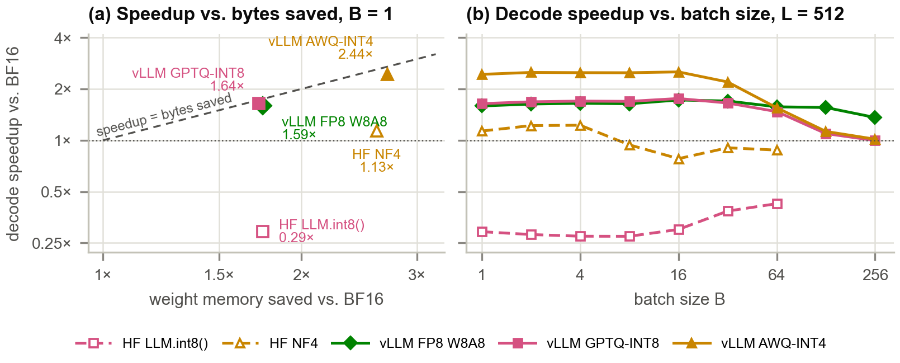
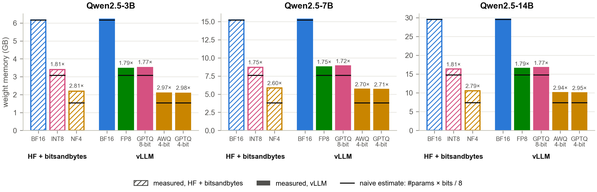
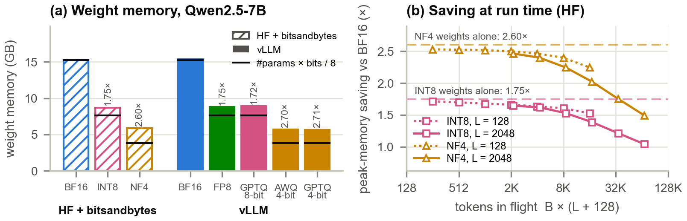
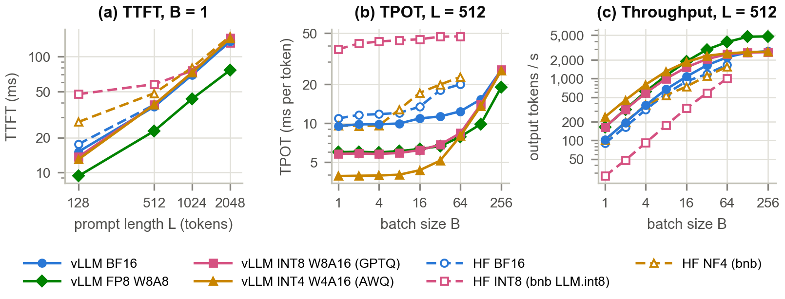
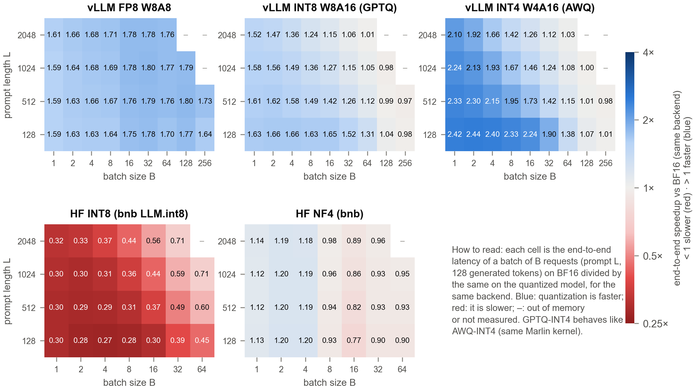
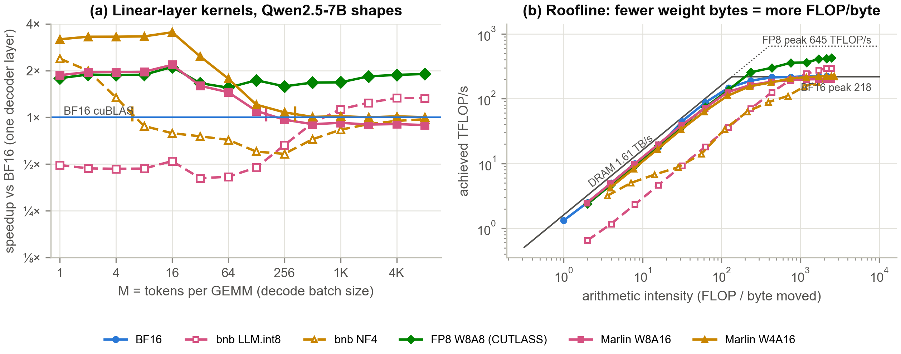
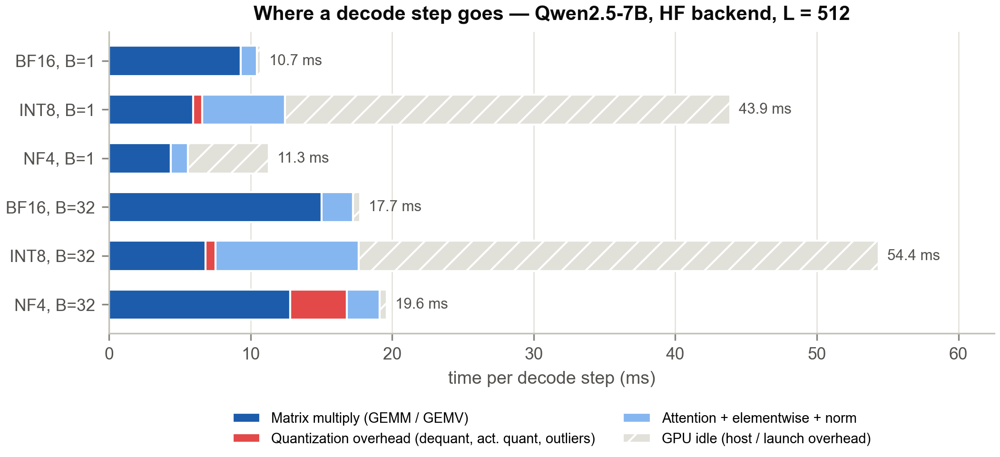
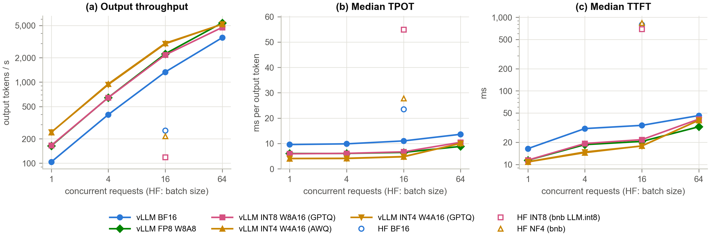
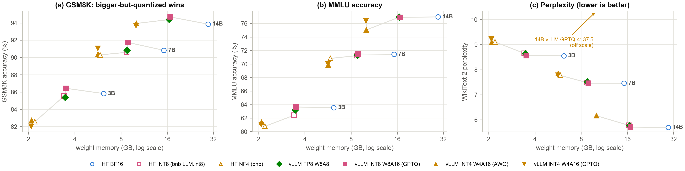
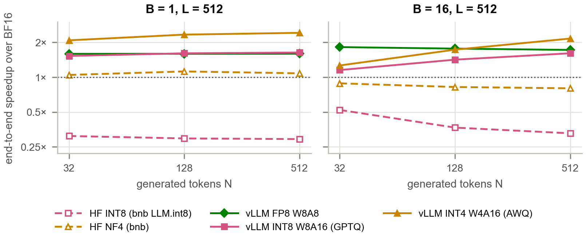

# Smaller Is Not Always Faster
### The memory–performance trade-off of LLM quantization on an RTX 5090

CSE 6359 Advanced Topics in Systems & Architecture — Final Project, Fall 2026
**Sijia Zhong · Zheng Zheng · Haofei Sun**

📄 **Report:** [`report/main.pdf`](report/main.pdf) (NeurIPS 2026 format: 9-page main text + appendix) · 🎞️ **Slides:** [`slides/final_presentation.pptx`](slides/final_presentation.pptx) · 📝 Proposal: [`proposal/`](proposal/)

<!-- KEY-FINDINGS -->
## Key findings



1. **Memory — smaller, but not 4× smaller.** Only the decoder's linear layers shrink; the embedding,
   LM head, norms and quantization scales stay 16-bit. On Qwen2.5-7B, 4-bit weights save
   **2.60×** (NF4) to **2.70×** (AWQ) instead of 4×, and INT8 **1.75×** instead of 2×.
   At run time the KV cache and activations are not quantized: at 32 × 2048-token prompts the
   end-to-end saving falls to **1.49×** (NF4) and **1.04×** (LLM.int8(), whose activation
   workspace is 1.6× that of BF16).
2. **Speed depends on the kernel, not the bit-width.** At batch size 1 the 7B model's 8-bit weights
   decode **1.64× faster** than BF16 with vLLM's Marlin kernel but **3.4× slower** with
   bitsandbytes LLM.int8(); its 4-bit weights decode **2.44× faster** with Marlin (AWQ) but only
   1.13× faster with bitsandbytes NF4, which is 1.39× slower on the host-bound 3B model.
3. **Weight-only gains vanish in the compute-bound regime.** AWQ-INT4 stops winning around
   **B ≈ 175** (512-token prompts) and never shortens prefill; **FP8 W8A8 is faster in every
   cell** (1.59×–1.80× end to end) and delivers **1.73×** the BF16 throughput at B = 256.
4. **The mechanism is visible at kernel level.** On the measured roofline, 4-bit weights quadruple
   arithmetic intensity, so Marlin W4A16 is 3.2× faster than cuBLAS at M = 1 and crosses over at
   M ≈ 333; LLM.int8() keeps the GPU busy only 28% of a decode step (BF16: 97%).
5. **Energy follows latency.** At batch size 1, AWQ-INT4 needs 1.9 J per token against
   4.9 J for BF16; at B = 256 the GPU is power-capped and only FP8 still saves energy.
6. **Quality (GSM8K, MMLU, perplexity; paired McNemar tests).** GPTQ-INT8 and FP8 stay within 0.9 points of BF16 on GSM8K and MMLU (LLM.int8() costs 1.1 MMLU points on 3B); 4-bit formats cost 0.6–2.8 MMLU points, most on the smallest model; Qwen2.5-14B in AWQ-INT4 (10.1 GB) beats Qwen2.5-7B in BF16 (15.2 GB) on GSM8K (93.9% vs 90.8%) and MMLU (75.1% vs 71.4%).
7. **One quality metric is not enough.** The 14B GPTQ-INT4 checkpoint keeps its GSM8K and MMLU scores
   but has a WikiText-2 perplexity of 37.5 (others: 5.71–6.16): it predicts the next
   token of raw text correctly only 37% of the time (60–62% for the other formats), but
   77% on chat-formatted text, like the others.
8. **The results carry over to Qwen3-8B.** AWQ-INT4 decodes 2.33× faster at batch 1 (Qwen2.5-7B:
   2.44×), FP8 1.54×, LLM.int8() runs at 0.28×; NF4 is 0.90× on the
   36-layer model, again because the decode step is host-bound.
9. **Quantization makes a 32B model possible.** Qwen3-32B needs 66 GB in BF16 and runs on this GPU only at
   4 bits: AWQ-INT4 takes 19.6 GB, decodes at 13.3 ms/token (Qwen3-8B BF16: 10.3 ms)
   and scores 94.2% / 78.1% on GSM8K / MMLU against 91.4% / 69.6% for
   Qwen3-8B in BF16 (16.4 GB).
<!-- /KEY-FINDINGS -->

## What we measured

| | |
|---|---|
| **GPU** | NVIDIA GeForce RTX 5090 (Blackwell, sm_120, 32 GB GDDR7, 170 SMs), driver 595.91 |
| **Software** | PyTorch 2.13 (CUDA 13.0), Transformers 5.19, bitsandbytes 0.50.2, vLLM 0.32 — pinned in [`requirements.txt`](requirements.txt) |
| **Models** | Qwen2.5-3B / 7B / 14B-Instruct; Qwen3-8B and Qwen3-32B (non-thinking mode) as a second model family — Qwen3-32B fits the 32 GB GPU only at 4 bits |
| **Configurations** | HF + bitsandbytes: BF16, INT8 (LLM.int8()), NF4 · vLLM: BF16, FP8 W8A8, GPTQ-INT8 (W8A16), AWQ-INT4 and GPTQ-INT4 (W4A16, Marlin kernels) |
| **Workloads** | controlled sweep (batch 1–256 × prompt 128–2048 tokens, 128 generated tokens) · output-length sweep (32–512 generated tokens) · 300 ShareGPT requests replayed at 1–64 concurrent clients · WikiText-2 perplexity · GSM8K (all 1,319 questions) · MMLU (all 14,042 questions) |
| **Metrics** | weight + peak memory, KV-cache capacity, TTFT, TPOT, throughput, GPU energy per token, perplexity, accuracy; kernel microbenchmarks, measured roofline, per-step profiles |

<!-- RESULTS -->
## Results at a glance

**Q1 — weight memory (GB)**

| Model       | Config             |   Naive (GB) |   Model (GB) |   Measured (GB) | Ratio vs BF16   | Naive ratio   |
|:------------|:-------------------|-------------:|-------------:|----------------:|:----------------|:--------------|
| Qwen2.5-3B  | HF BF16            |         6.17 |         6.17 |            6.17 | 1.00×    | 1.00×  |
| Qwen2.5-3B  | HF INT8 (LLM.int8) |         3.09 |         3.4  |            3.4  | 1.81×    | 2.00×  |
| Qwen2.5-3B  | HF NF4             |         1.54 |         2.18 |            2.2  | 2.81×    | 4.00×  |
| Qwen2.5-3B  | vLLM BF16          |         6.17 |         6.17 |            6.22 | 1.00×    | 1.00×  |
| Qwen2.5-3B  | vLLM FP8 W8A8      |         3.09 |         3.4  |            3.47 | 1.79×    | 2.00×  |
| Qwen2.5-3B  | vLLM GPTQ W8A16    |         3.09 |         3.46 |            3.51 | 1.77×    | 2.00×  |
| Qwen2.5-3B  | vLLM AWQ W4A16     |         1.54 |         2.06 |            2.09 | 2.97×    | 4.00×  |
| Qwen2.5-3B  | vLLM GPTQ W4A16    |         1.54 |         2.06 |            2.08 | 2.98×    | 4.00×  |
| Qwen2.5-7B  | HF BF16            |        15.23 |        15.23 |           15.23 | 1.00×    | 1.00×  |
| Qwen2.5-7B  | HF INT8 (LLM.int8) |         7.62 |         8.71 |            8.71 | 1.75×    | 2.00×  |
| Qwen2.5-7B  | HF NF4             |         3.81 |         5.85 |            5.85 | 2.60×    | 4.00×  |
| Qwen2.5-7B  | vLLM BF16          |        15.23 |        15.23 |           15.34 | 1.00×    | 1.00×  |
| Qwen2.5-7B  | vLLM FP8 W8A8      |         7.62 |         8.71 |            8.77 | 1.75×    | 2.00×  |
| Qwen2.5-7B  | vLLM GPTQ W8A16    |         7.62 |         8.86 |            8.9  | 1.72×    | 2.00×  |
| Qwen2.5-7B  | vLLM AWQ W4A16     |         3.81 |         5.57 |            5.68 | 2.70×    | 4.00×  |
| Qwen2.5-7B  | vLLM GPTQ W4A16    |         3.81 |         5.57 |            5.66 | 2.71×    | 4.00×  |
| Qwen2.5-14B | HF BF16            |        29.54 |        29.54 |           29.54 | 1.00×    | 1.00×  |
| Qwen2.5-14B | HF INT8 (LLM.int8) |        14.77 |        16.33 |           16.34 | 1.81×    | 2.00×  |
| Qwen2.5-14B | HF NF4             |         7.39 |        10.55 |           10.58 | 2.79×    | 4.00×  |
| Qwen2.5-14B | vLLM BF16          |        29.54 |        29.54 |           29.6  | 1.00×    | 1.00×  |
| Qwen2.5-14B | vLLM FP8 W8A8      |        14.77 |        16.33 |           16.51 | 1.79×    | 2.00×  |
| Qwen2.5-14B | vLLM GPTQ W8A16    |        14.77 |        16.64 |           16.73 | 1.77×    | 2.00×  |
| Qwen2.5-14B | vLLM AWQ W4A16     |         7.39 |         9.98 |           10.07 | 2.94×    | 4.00×  |
| Qwen2.5-14B | vLLM GPTQ W4A16    |         7.39 |         9.98 |           10.02 | 2.95×    | 4.00×  |





**Q2 — latency and throughput, Qwen2.5-7B, prompt 512, 128 output tokens**

| Config             |   TTFT B=1 (ms) |   TPOT B=1 (ms) |   TPOT B=64 (ms) |   tok/s B=64 | Decode speedup B=1   |   mJ/token B=1 |   mJ/token B=64 |
|:-------------------|----------------:|----------------:|-----------------:|-------------:|:---------------------|---------------:|----------------:|
| HF BF16            |            38.4 |           10.9  |            20.04 |         1669 | 1.00×         |           5092 |             294 |
| HF INT8 (LLM.int8) |            57.8 |           37.45 |            47.14 |         1003 | 0.29×         |           6187 |             305 |
| HF NF4             |            48.3 |            9.62 |            22.87 |         1550 | 1.13×         |           3188 |             340 |
| vLLM BF16          |            37   |            9.52 |            12.39 |         2209 | 1.00×         |           4878 |             249 |
| vLLM FP8 W8A8      |            22.8 |            5.99 |             7.88 |         3886 | 1.59×         |           2507 |             141 |
| vLLM GPTQ W8A16    |            38.5 |            5.8  |             8.41 |         2471 | 1.64×         |           2588 |             234 |
| vLLM AWQ W4A16     |            38.6 |            3.9  |             7.99 |         2544 | 2.44×         |           1919 |             224 |
| vLLM GPTQ W4A16    |            36.9 |            3.88 |             7.89 |         2642 | 2.45×         |           1840 |             219 |




**Q3 — where each format stops winning (speedup over BF16 on the same backend)**

| Config             | Decode B=1   | Decode max B     | Decode wins up to   | E2E B=1   | E2E max B        | E2E wins up to   |
|:-------------------|:-----------------|:-------------------|:--------------------|:--------------|:-------------------|:-----------------|
| HF INT8 (LLM.int8) | 0.29×     | 0.43× (64)  | never               | 0.30×  | 0.60× (64)  | never            |
| HF NF4             | 1.13×     | 0.88× (64)  | B≈7         | 1.12×  | 0.93× (64)  | B≈7      |
| vLLM FP8 W8A8      | 1.59×     | 1.36× (256) | all B             | 1.59×  | 1.73× (256) | all B          |
| vLLM GPTQ W8A16    | 1.64×     | 1.00× (256) | B≈251       | 1.61×  | 0.97× (256) | B≈123    |
| vLLM AWQ W4A16     | 2.44×     | 1.02× (256) | all B             | 2.33×  | 0.98× (256) | B≈175    |
| vLLM GPTQ W4A16    | 2.45×     | 1.05× (256) | all B             | 2.35×  | 1.03× (256) | all B          |






**Real workload — 300 ShareGPT requests**

| Config           |   C |   req/s |   tok/s | TTFT p50 / p99   | TPOT p50 / p99   |
|:-----------------|------:|--------:|--------:|:-----------------|:-----------------|
| HF BF16 (static) |    16 |    0.84 |     254 | 797 / 1244       | 23.5 / 29.7      |
| HF INT8 (static) |    16 |    0.39 |     119 | 691 / 1158       | 54.9 / 64.1      |
| HF NF4 (static)  |    16 |    0.72 |     215 | 842 / 1271       | 27.8 / 35.4      |
| vLLM BF16        |     1 |    0.35 |     104 | 16 / 62          | 9.6 / 9.6        |
| vLLM BF16        |    64 |   11.76 |    3537 | 46 / 1654        | 13.6 / 16.7      |
| vLLM FP8         |     1 |    0.54 |     164 | 11 / 44          | 6.1 / 6.2        |
| vLLM FP8         |    64 |   17.92 |    5388 | 33 / 1485        | 8.9 / 15.1       |
| vLLM GPTQ-8      |     1 |    0.55 |     166 | 11 / 63          | 6.0 / 6.2        |
| vLLM GPTQ-8      |    64 |   15.74 |    4733 | 41 / 1743        | 10.5 / 18.0      |
| vLLM AWQ-4       |     1 |    0.8  |     240 | 11 / 65          | 4.1 / 4.5        |
| vLLM AWQ-4       |    64 |   17.23 |    5180 | 40 / 1747        | 10.1 / 14.8      |
| vLLM GPTQ-4      |     1 |    0.8  |     241 | 11 / 62          | 4.1 / 4.4        |
| vLLM GPTQ-4      |    64 |   17.23 |    5181 | 40 / 1722        | 10.0 / 19.3      |




**Q4 — quality**

| Model       | Config      | PPL                | \DeltaPPL   |   GSM8K | \Delta   | p      |   MMLU | \Delta\,   | p\,    |
|:------------|:------------|:-------------------|:--------------|--------:|:-----------|:---------|-------:|:-------------|:---------|
| Qwen2.5-3B  | HF BF16     | 8.56               | --            |    85.8 | --         | --       |   63.5 | --           | --       |
|             | HF INT8     | 8.66               | +0.10       |    85.5 | -0.3     | 0.777    |   62.4 | -1.1       | <0.001 |
|             | HF NF4      | 9.11               | +0.55       |    82.6 | -3.3     | <0.001 |   60.8 | -2.8       | <0.001 |
|             | vLLM BF16   | 8.56               | 0.00        |    86   | +0.2     | 0.871    |   63.7 | +0.1       | 0.075    |
|             | vLLM FP8    | 8.64               | +0.09       |    85.4 | -0.5     | 0.610    |   63.2 | -0.4       | 0.038    |
|             | vLLM GPTQ-8 | 8.56               | 0.00        |    86.4 | +0.6     | 0.322    |   63.6 | +0.1       | 0.261    |
|             | vLLM AWQ-4  | 9.10               | +0.54       |    82.7 | -3.1     | 0.002    |   61.4 | -2.2       | <0.001 |
|             | vLLM GPTQ-4 | 9.22               | +0.66       |    82   | -3.8     | <0.001 |   61.1 | -2.5       | <0.001 |
| Qwen2.5-7B  | HF BF16     | 7.46               | --            |    90.8 | --         | --       |   71.4 | --           | --       |
|             | HF INT8     | 7.49               | +0.03       |    90.6 | -0.2     | 0.771    |   71.2 | -0.2       | 0.134    |
|             | HF NF4      | 7.77               | +0.31       |    90.3 | -0.5     | 0.500    |   70.8 | -0.6       | 0.002    |
|             | vLLM BF16   | 7.46               | 0.00        |    91.2 | +0.4     | 0.359    |   71.4 | 0.0        | 0.704    |
|             | vLLM FP8    | 7.51               | +0.05       |    90.8 | 0.0      | 1.000    |   71.3 | -0.1       | 0.327    |
|             | vLLM GPTQ-8 | 7.46               | 0.00        |    91.7 | +0.9     | 0.043    |   71.5 | 0.0        | 0.610    |
|             | vLLM AWQ-4  | 7.85               | +0.39       |    90.4 | -0.5     | 0.576    |   69.9 | -1.6       | <0.001 |
|             | vLLM GPTQ-4 | 7.78               | +0.32       |    91.1 | +0.2     | 0.828    |   70   | -1.4       | <0.001 |
| Qwen2.5-14B | HF BF16     | 5.70               | --            |    93.9 | --         | --       |   77   | --           | --       |
|             | HF INT8     | 5.78               | +0.08       |    94.5 | +0.6     | 0.280    |   76.6 | -0.3       | 0.025    |
|             | HF NF4      | 6.07               | +0.37       |    93.2 | -0.7     | 0.281    |   76.4 | -0.6       | 0.003    |
|             | vLLM FP8    | 5.77               | +0.07       |    94.4 | +0.5     | 0.371    |   76.9 | 0.0        | 0.862    |
|             | vLLM GPTQ-8 | 5.71               | +0.01       |    94.7 | +0.8     | 0.013    |   76.9 | -0.1       | 0.416    |
|             | vLLM AWQ-4  | 6.16               | +0.46       |    93.9 | +0.1     | 1.000    |   75.1 | -1.9       | <0.001 |
|             | vLLM GPTQ-4 | 37.46^{\ddagger} | +31.77      |    93.7 | -0.2     | 0.899    |   76.4 | -0.6       | 0.005    |
| Qwen3-8B    | HF BF16     | 9.73               | --            |    91.4 | --         | --       |   69.6 | --           | --       |
|             | HF INT8     | 9.72               | 0.00        |    92   | +0.6     | 0.382    |   70.3 | +0.7       | <0.001 |
|             | HF NF4      | 9.98               | +0.25       |    91.5 | +0.2     | 0.909    |   69.3 | -0.3       | 0.156    |
|             | vLLM BF16   | 9.72               | 0.00        |    92   | +0.6     | 0.215    |   69.6 | 0.0        | 0.610    |
|             | vLLM FP8    | 9.73               | 0.00        |    91.8 | +0.5     | 0.488    |   68.9 | -0.7       | <0.001 |
|             | vLLM AWQ-4  | 10.18              | +0.46       |    91.1 | -0.2     | 0.818    |   68.9 | -0.7       | 0.003    |
| Qwen3-32B   | HF NF4      | 7.93               | --            |    92.6 | --         | --       |   79.4 | --           | --       |
|             | vLLM AWQ-4  | 7.88^{\S}        | --            |    94.2 | --         | --       |   78.1 | --           | --       |




**Does it generalize? Qwen2.5-7B vs Qwen3-8B**

| Metric (vs.\ BF16)                  | Qwen2.5-7B        | Qwen3-8B          |
|:------------------------------------|:------------------|:------------------|
| Weight saving, AWQ-INT4 (vLLM)      | 2.70×      | 2.67×      |
| Weight saving, NF4 (HF)             | 2.60×      | 2.55×      |
| Decode speedup B=1, AWQ-INT4      | 2.44×      | 2.33×      |
| Decode speedup B=1, FP8           | 1.59×      | 1.54×      |
| Decode speedup B=1, NF4           | 1.13×      | 0.90×      |
| Decode speedup B=1, LLM.int8()    | 0.29×      | 0.28×      |
| Throughput B=64, AWQ-INT4         | 1.15×      | 1.12×      |
| Throughput B=64, FP8              | 1.76×      | 1.67×      |
| GSM8K \Delta pp (p), FP8        | 0.0 (1.000)     | +0.5 (0.488)    |
| GSM8K \Delta pp (p), LLM.int8() | -0.2 (0.771)    | +0.6 (0.382)    |
| GSM8K \Delta pp (p), AWQ-INT4   | -0.5 (0.576)    | -0.2 (0.818)    |
| GSM8K \Delta pp (p), NF4        | -0.5 (0.500)    | +0.2 (0.909)    |
| MMLU \Delta pp (p), FP8         | -0.1 (0.327)    | -0.7 (<0.001) |
| MMLU \Delta pp (p), LLM.int8()  | -0.2 (0.134)    | +0.7 (<0.001) |
| MMLU \Delta pp (p), AWQ-INT4    | -1.6 (<0.001) | -0.7 (0.003)    |
| MMLU \Delta pp (p), NF4         | -0.6 (0.002)    | -0.3 (0.156)    |


**Output length — end-to-end speedup vs generated tokens**


<!-- /RESULTS -->

## Repository layout

```
final_project/
├── quantbench/            measurement library (loading, timing, NVML energy/memory monitor,
│                          analytic memory model, workloads, aggregation, plot style)
├── scripts/               one script per experiment + figure/table generation
│   ├── hf_sweep.py        precision × batch × prompt-length sweep, Hugging Face + bitsandbytes
│   ├── vllm_sweep.py      the same sweep on vLLM
│   ├── kernel_bench.py    linear-layer kernels vs. batch size (cuBLAS, bnb, CUTLASS FP8, Marlin)
│   ├── hw_peaks.py        measured DRAM bandwidth and BF16/FP8/INT8 GEMM ceilings
│   ├── profile_decode.py  torch.profiler breakdown of one decode step
│   ├── serve_bench.sh     ShareGPT replay against a vLLM server (`vllm bench serve`)
│   ├── hf_sharegpt.py     the same requests with HF static batching
│   ├── eval_ppl.py        WikiText-2 perplexity (HF or vLLM)
│   ├── eval_gsm8k.py      GSM8K accuracy (HF or vLLM)
│   ├── eval_mmlu.py       MMLU accuracy (HF or vLLM)
│   ├── diag_ppl_topk.py   next-token ranking on raw vs chat text (perplexity-outlier diagnosis)
│   └── make_figures.py · make_tables.py · make_numbers.py · make_readme.py
├── results/               raw measurements (*.jsonl), serving results, summaries (CSV/Markdown), env info
├── figures/               all figures (PDF for the report, PNG for the slides and this README)
├── report/                LaTeX source (NeurIPS 2026 style) and PDF of the final report
├── slides/                final presentation (UTA template) and its build script
└── proposal/              proposal slides and write-up
```

## Reproduce

```bash
cd final_project
uv venv .venv --python 3.12 && source .venv/bin/activate
uv pip install -r requirements.txt
bash run_all.sh                      # every experiment, about twelve GPU-hours on an RTX 5090
python scripts/make_figures.py       # figures/*.pdf|png
python scripts/make_tables.py        # results/summary/* and report/tables/*
python scripts/make_numbers.py       # report/numbers.tex (every number quoted in the report)
python scripts/make_readme.py        # key findings and result tables in this README
(cd report && tectonic main.tex)     # report/main.pdf
python slides/build_slides.py        # slides/final_presentation.pptx
```

Notes: vLLM's FlashInfer sampler needs `nvcc` for JIT compilation, which our machine does not have, so
all scripts set `VLLM_USE_FLASHINFER_SAMPLER=0` (we decode greedily, so the sampler is never on the
critical path). Raw JSONL rows carry the full environment (`env`) of the run that produced them.
